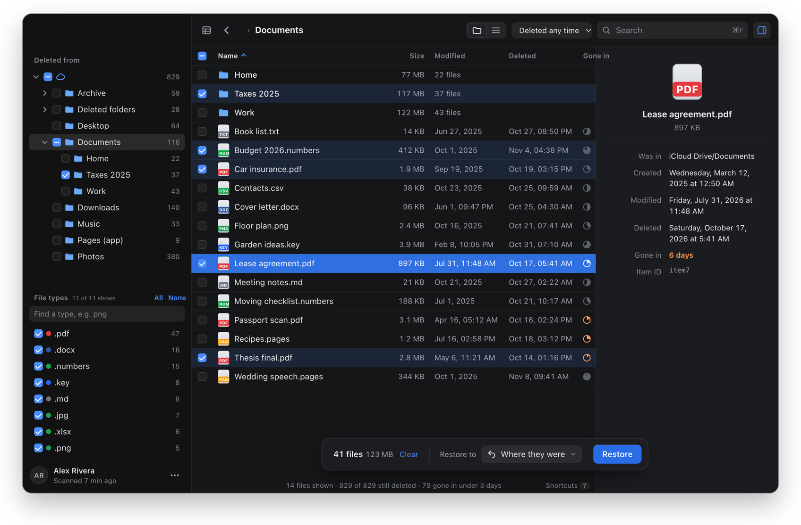
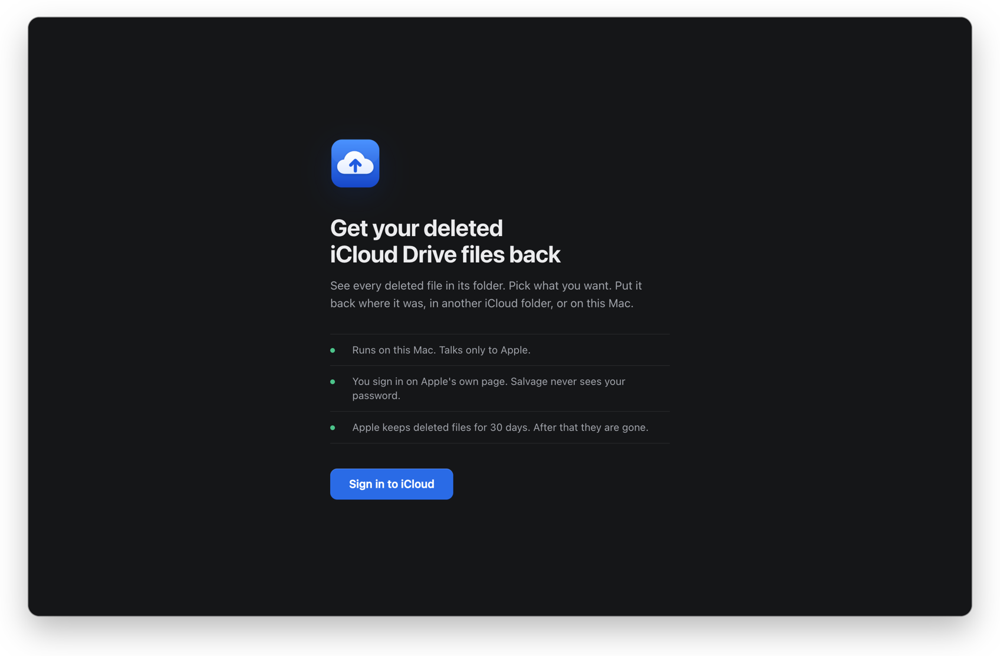
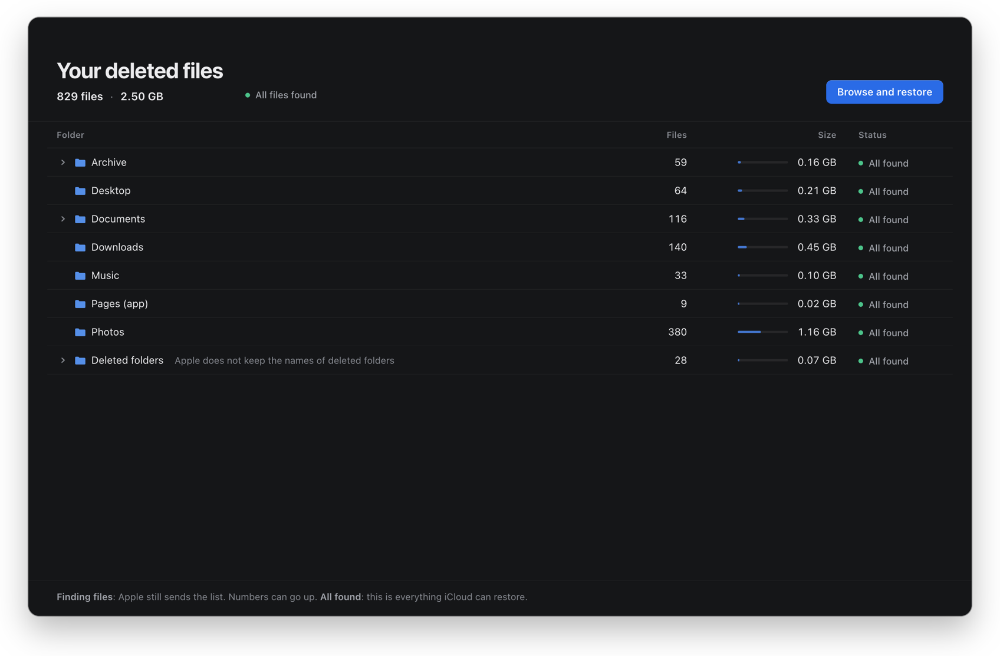
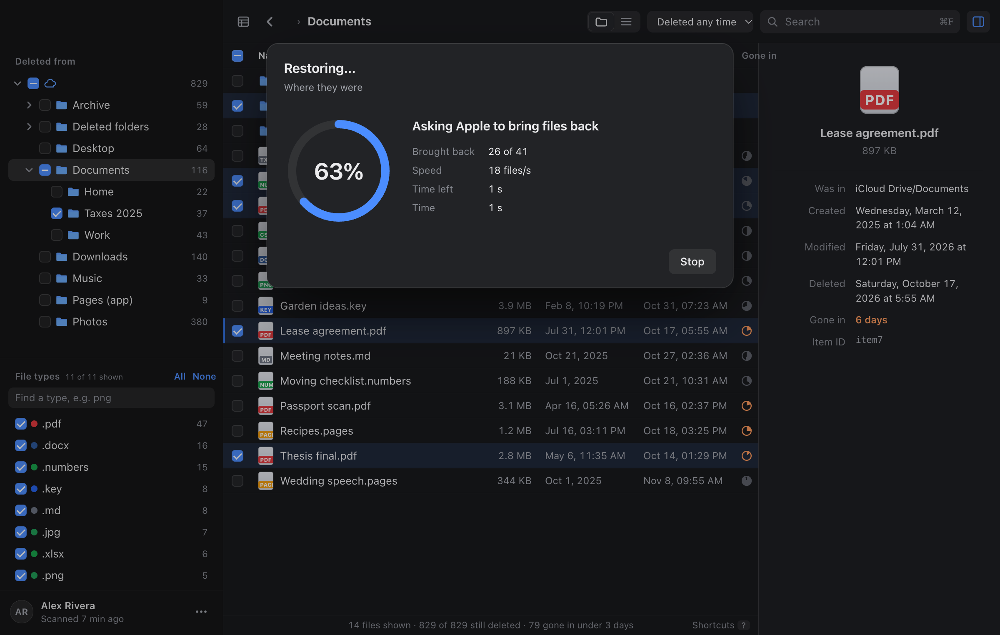
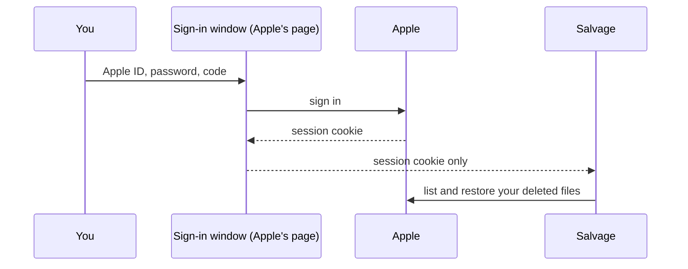

# Salvage

Get your deleted iCloud Drive files back, fast.



Apple keeps deleted iCloud Drive files for about 30 days. The only official way to get them back is the "Restore Files" page on icloud.com. With thousands of files, that page is slow, it has no folders, and it is easy to miss things.

Salvage is a small native Mac app that does the same job better:

- It shows every deleted file in its folder tree, with size and dates.
- Tick folders or files, or filter by file type.
- It restores them where they were, to another iCloud Drive folder, or downloads them to a folder on your Mac.
- It finds duplicate copies and hides them.
- It handles tens of thousands of files. When Apple is busy, it waits and tries again.
- It remembers what it already restored, so a second run only does what is left.

It was built to save 57 GB of files that the web page could not handle. In one run it restored 58,013 files with 0 failures.

## How it works

1. You sign in on Apple's own sign-in page, inside the app. Salvage never sees your password.<br>
   Read more: [Sign in: only with Apple](#sign-in-only-with-apple).
2. Salvage reads the list of deleted files from the same iCloud web service that icloud.com uses.
3. You pick what to restore. Salvage asks Apple to bring the files back, then moves or downloads them if you asked for that.

Everything runs on your Mac. Salvage talks only to Apple. It sends nothing anywhere else.

Its own data (the file list and what was restored) is kept in this folder:

```
~/Library/Application Support/io.github.haim-ari.salvage/
```

## Screenshots

| Sign in | All your deleted files |
| --- | --- |
|  |  |

| Pick files | Restore |
| --- | --- |
|  |  |

The screenshots use made-up example files and a made-up account.

## Sign in: only with Apple

You sign in to Apple, not to Salvage. Salvage never gets your Apple ID password or your two-factor code.

- **Apple's own page.** "Sign in to iCloud" opens a window with Apple's page:<br>
  `https://www.icloud.com/iclouddrive/`<br>
  You type your Apple ID, password and code there, the same as in Safari.
- **Only Apple can load in that window.** It loads only Apple sites over HTTPS (`icloud.com`, `apple.com` and Apple's file and content hosts). It blocks every other page.
- **Salvage does not read what you type.** After you sign in, Apple gives the window a session cookie (a small sign-in ticket). Salvage takes only that ticket, checks it with Apple, and closes the window.
- **The ticket stays on your Mac.** It is kept in memory and in macOS's own web view storage, not in Salvage's files. It is sent only to Apple.
- **Sign out removes it.** "Sign out" in the account menu ends the session and clears all of the sign-in window's data from your Mac.
- **Advanced Data Protection works.** Salvage waits for the extra keys Apple sets for it.



You can check this in the code:<br>
[`src-tauri/src/auth.rs`](src-tauri/src/auth.rs)

## Important

- Salvage is not made by Apple and is not supported by Apple. It uses the same private web service as icloud.com. Apple can change that service at any time, and then Salvage can stop working.
- Use it at your own risk. It is MIT licensed, with no warranty.
- Restored files take space in your iCloud storage. Check that you have enough free space first.

## Download

Get the DMG from [Releases](https://github.com/haim-ari/salvage/releases):<br>
`Salvage-<version>-macos-arm64.dmg`

It is for Macs with Apple silicon (M1 or later). For an Intel Mac, build it yourself (see below).

1. Open the DMG.
2. Drag `Salvage` to `Applications`.

The app is not signed by Apple. The first time, macOS blocks it. To open it, right-click `Salvage.app` in Applications and pick **Open**, then **Open** again.

If that does not work, run this once, then open the app:

```bash
xattr -dr com.apple.quarantine /Applications/Salvage.app
```

## Build

You need macOS 13 or later, [Rust](https://rustup.rs) 1.90 or later, [bun](https://bun.sh) and [just](https://just.systems) (`brew install just`).

```bash
just app
```

The app is in this folder:

```
src-tauri/target/release/bundle/macos/Salvage.app
```

To run it while you work on it:

```bash
bun run dev
```

Run `just` to see all tasks.

## Release

Releases are automatic. You do not run anything.

1. Open a pull request. CI runs `cargo fmt`, `cargo clippy` and `cargo test`. [CodeRabbit](https://coderabbit.ai) reviews the code. Its settings are in `.coderabbit.yaml`.
2. Merge it to `main`. You cannot push to `main` directly.
3. [semantic-release](https://semantic-release.gitbook.io) reads the commit messages since the last tag:
   - `fix:` makes a patch release (0.2.0 → 0.2.1).
   - `feat:` makes a minor release (0.2.0 → 0.3.0).
   - `feat!:` or a `BREAKING CHANGE:` footer makes a major release.
   - Other types (`docs:`, `chore:`, `ci:`) make no release.
4. For a release, CI sets the version, builds the DMG, tags `v<version>` and publishes it on [Releases](https://github.com/haim-ari/salvage/releases).

The git tag holds the version. The version in the files on `main` is not updated.

To make a DMG on your Mac with no release, run `just dmg-file`.

## Code layout

- `src-tauri/src/api.rs`: the iCloud web service calls (list, recover, move, download).
- `src-tauri/src/auth.rs`: sign-in in a web view, reading the session cookies.
- `src-tauri/src/model.rs`: the snapshot of deleted files and folders.
- `src-tauri/src/copies.rs`: finds duplicate copies.
- `src-tauri/src/restore.rs`: the restore job, with batches, retries and progress.
- `src-tauri/src/store.rs`: what is saved on disk.
- `ui/`: the interface (plain HTML, CSS and JavaScript).

## License

[MIT](LICENSE)
